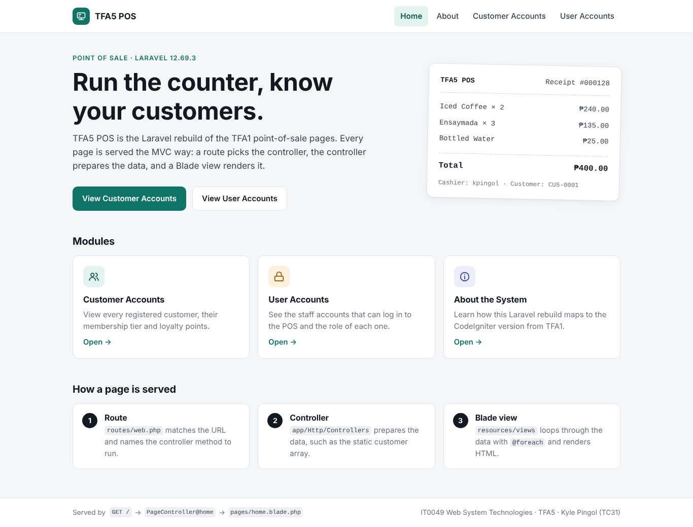
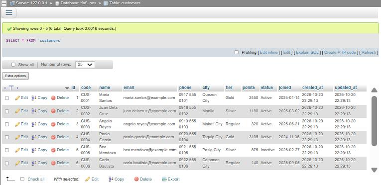

# TFA5 POS: From Zero to Four Pages, Again (Laravel)

**IT0049 Web System Technologies · Technical Formative Assessment 5**
Kyle Pingol · TC31 · Dr. Roman Villones

A rebuild of the TFA1 Point of Sale (POS) application in **Laravel 12**. It has four pages. The two account pages read from a **static PHP array** as a temporary data source.

- **Live site:** __LIVE_URL__
- **Repository:** __REPO_URL__

| Page | URL | Route name | Controller method | Blade view |
|---|---|---|---|---|
| Landing page | `/` | `home` | `PageController@home` | `resources/views/pages/home.blade.php` |
| About page | `/about` | `about` | `PageController@about` | `resources/views/pages/about.blade.php` |
| Customer Accounts | `/customers` | `customers.index` | `CustomerController@index` | `resources/views/customers/index.blade.php` |
| User Accounts | `/users` | `users.index` | `UserController@index` | `resources/views/users/index.blade.php` |



---

## How the MVC pieces fit

The responsibilities are the same as in the CodeIgniter 4 version from TFA1. Only the file names and syntax change.

1. **Route** (`routes/web.php`): matches the URL and picks the controller method.
2. **Controller** (`app/Http/Controllers`): prepares the data. `CustomerController` and `UserController` each define a `private static array` with **6 sample records**.
3. **View** (`resources/views`): a Blade template loops through the array with `@foreach` and renders the HTML. Every page extends one layout (`layouts/app.blade.php`) and shares one navigation bar (`partials/nav.blade.php`).

```php
// routes/web.php
Route::get('/', [PageController::class, 'home'])->name('home');
Route::get('/about', [PageController::class, 'about'])->name('about');
Route::get('/customers', [CustomerController::class, 'index'])->name('customers.index');
Route::get('/users', [UserController::class, 'index'])->name('users.index');
```

```blade
{{-- resources/views/customers/index.blade.php --}}
@foreach ($customers as $customer)
    <tr>
        <td>{{ $customer['code'] }}</td>
        <td>{{ $customer['name'] }}</td>
        ...
    </tr>
@endforeach
```

The footer of every page shows the route → controller → view that served it.

| | CodeIgniter 4 (TFA1) | Laravel (TFA5) |
|---|---|---|
| Routes | `app/Config/Routes.php` | `routes/web.php` |
| Controllers | `app/Controllers/` | `app/Http/Controllers/` |
| Views | `app/Views/*.php` | `resources/views/*.blade.php` |
| Loop | `<?php foreach (...): ?>` | `@foreach (...)` |
| CLI | `php spark` | `php artisan` |
| Dev server | `php spark serve` | `php artisan serve` |

---

## Project structure (files written for this activity)

```
app/
  Http/Controllers/
    PageController.php        # home() and about()
    CustomerController.php    # static array of 6 customers + index()
    UserController.php        # static array of 6 users + index()
  Models/
    Customer.php              # model for the customers table
    User.php                  # model for the users table (POS fields added)
database/
  migrations/
    0001_01_01_000000_create_users_table.php      # users + POS fields (username, role, status, last_login_at)
    2026_10_20_142106_create_customers_table.php  # customers table
  seeders/
    DatabaseSeeder.php        # calls the two seeders below
    UserSeeder.php            # same 6 users as UserController
    CustomerSeeder.php        # same 6 customers as CustomerController
  export/
    tfa5_pos.sql              # MySQL/MariaDB export (phpMyAdmin import)
public/css/pos.css            # styles (plain CSS, no build step)
resources/views/
  layouts/app.blade.php       # master layout (@yield)
  partials/nav.blade.php      # navigation links to all four pages
  pages/home.blade.php
  pages/about.blade.php
  customers/index.blade.php   # @foreach over $customers
  users/index.blade.php       # @foreach over $users
routes/web.php                # the four routes
tests/Feature/
  PosPagesTest.php            # every page, nav links, 5+ records rendered
  DatabaseSeederTest.php      # migrations + seeders work
```

---

## Requirements

- PHP **8.2 or newer** (XAMPP 8.2.x works)
- [Composer](https://getcomposer.org/download/)
- XAMPP MySQL/MariaDB. This is only needed for the migrations and seeders. The four pages run without a database.

## Setup and run locally

```bash
git clone __REPO_URL__.git
cd TFA5-Laravel-POS

composer install
cp .env.example .env          # Windows CMD: copy .env.example .env
php artisan key:generate

php artisan serve
```

Open **http://127.0.0.1:8000**. On Windows you can also double-click **`run-local.bat`**. It runs the same steps for you.

### Database (migrations and seeders)

`.env.example` is already set up for XAMPP: `DB_CONNECTION=mysql`, database `tfa5_pos`, user `root`, no password.

**Option A: Artisan.** Start MySQL in the XAMPP Control Panel, then run:

```bash
php artisan migrate --seed    # answer "yes" if it offers to create the tfa5_pos database
```

**Option B: phpMyAdmin.** Open http://localhost/phpmyadmin, go to **Import**, choose `database/export/tfa5_pos.sql`, and click **Import**.

Either way you get the `customers` and `users` tables with the same 6 records each that the pages show. All seeded accounts use the demo password `password`.



---

## Artisan commands used

```bash
php artisan --version
php artisan make:controller PageController
php artisan make:controller CustomerController
php artisan make:controller UserController
php artisan make:model Customer -m        # model + migration
php artisan make:seeder CustomerSeeder
php artisan make:seeder UserSeeder
php artisan make:test PosPagesTest
php artisan route:list --except-vendor    # inspect the four routes
php artisan migrate --seed
php artisan serve
php artisan test
```

```
GET|HEAD  /          home › PageController@home
GET|HEAD  about      about › PageController@about
GET|HEAD  customers  customers.index › CustomerController@index
GET|HEAD  users      users.index › UserController@index
```

## Tests

```bash
php artisan test
```

The tests check that every route returns 200 with the right Blade view, and that every page links to all four pages. They also check that the account pages render at least 5 records from the static arrays, and that the migrations and seeders create 6 customers and 6 users.

## Deployment (Railway)

The app is deployed from this GitHub repository on [Railway](https://railway.com). Railway's Railpack builder detects Laravel, runs `composer install`, and serves `public/` with FrankenPHP. Service variables:

```
APP_NAME="TFA5 POS"
APP_ENV=production
APP_DEBUG=false
APP_KEY=base64:...            # generated with php artisan key:generate --show
APP_URL=__LIVE_URL__
LOG_CHANNEL=stderr
DB_CONNECTION=sqlite
SESSION_DRIVER=file
CACHE_STORE=file
QUEUE_CONNECTION=sync
```

Every push to `main` redeploys the site.
